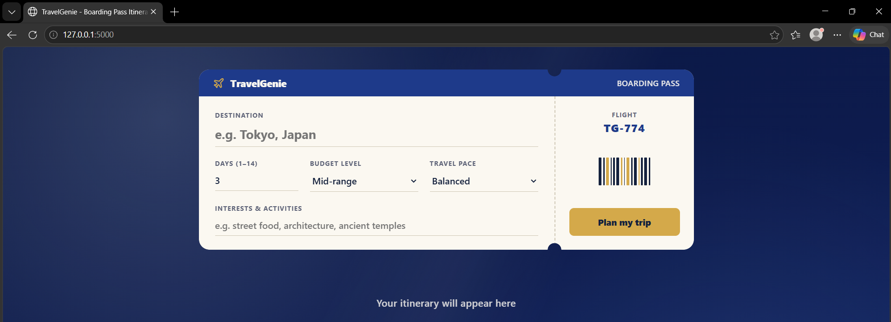
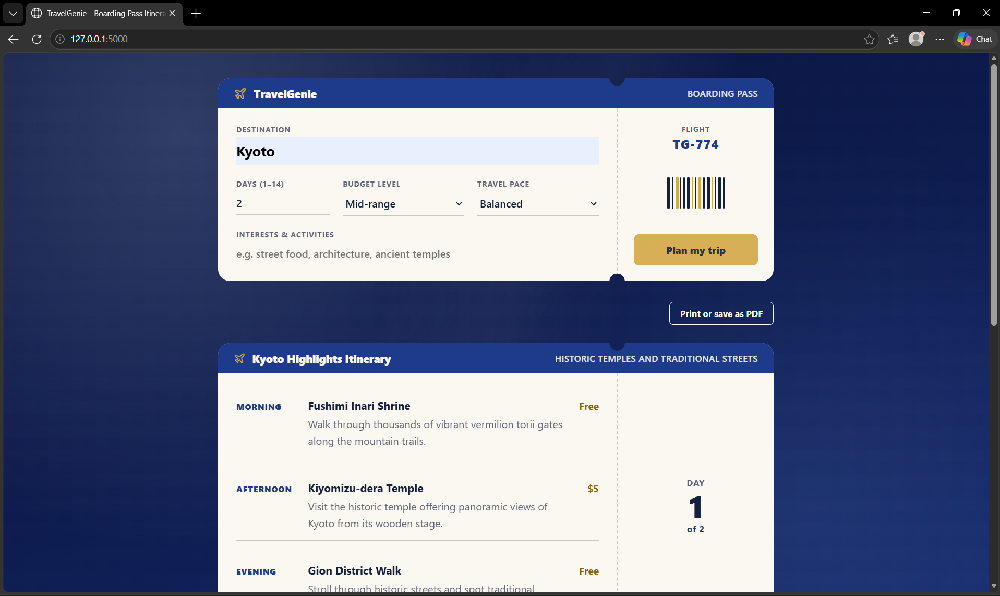
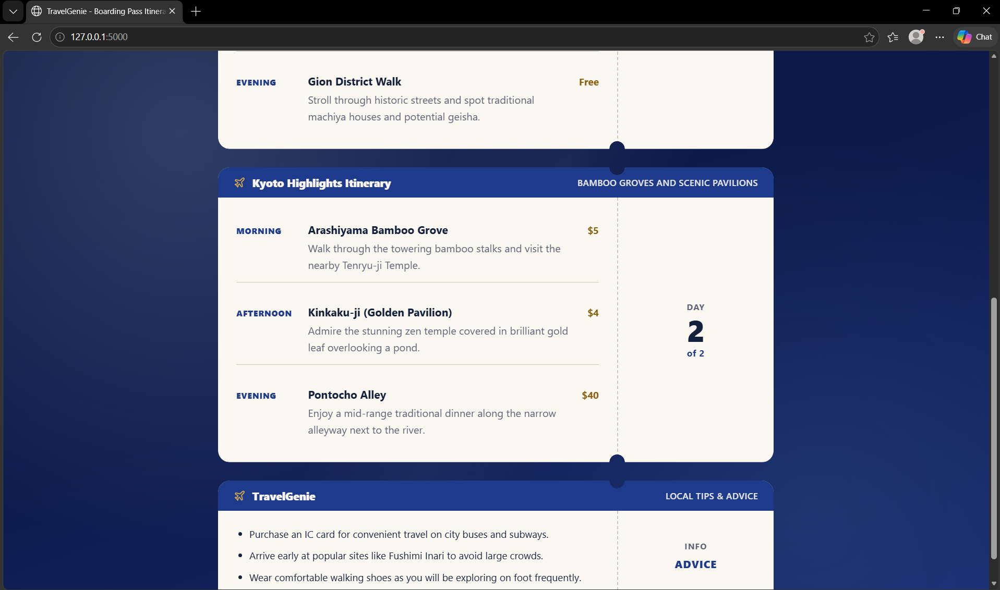

# TravelGenie

TravelGenie is an AI-powered travel planner that turns a destination, trip length, budget, pace, and interests into a day-by-day itinerary.

Live demo: https://travel-gennie.onrender.com/

## Screenshots







## Features

- Boarding pass interface: Itineraries are presented as vintage aviation passes with ticket stubs and day counters.
- Day-by-day itineraries: Structured schedules featuring time slots, activity titles, short descriptions, rough cost estimates, and local tips.
- Input validation: Client and server checks for trip duration (1 to 14 days), destination length, budget tier, and travel pace.
- Clear error messages: User-friendly feedback for rate limits, request timeouts, service unavailability, and connection issues.
- Print and PDF export: A dedicated button and print stylesheet format the itinerary cleanly for physical printing or saving as a PDF.
- Sample preview mode: Visiting `/?demo=1` loads a pre-built Kyoto itinerary without needing an API key or contacting the AI service.

## Tech stack

- Python
- Flask
- OpenAI Python SDK
- HTML
- CSS
- JavaScript

## How it works

1. Form submission: The user enters a destination, duration (1–14 days), budget, pace, and interests.
2. Flask validates: The server checks and sanitizes all inputs, returning HTTP 400 if validation fails.
3. Prompt sent in JSON mode: Flask constructs prompts with structure and length rules and requests a JSON object from the model.
4. Reply checked: The server inspects the returned JSON to verify that days and activities lists are present and structured correctly.
5. Page renders it: Client-side JavaScript builds boarding pass cards and inserts them into the page.

## Setup

Follow these steps to set up and run the application locally on Windows PowerShell.

1. Clone the repository and enter the directory:

```powershell
git clone <repo-url>
cd "travel gennie"
```

2. Create and activate a Python virtual environment:

```powershell
python -m venv venv
.\venv\Scripts\Activate.ps1
```

On macOS or Linux, activate the virtual environment with:
```bash
source venv/bin/activate
```

3. Install dependencies:

```powershell
pip install -r requirements.txt
```

4. Create your local `.env` configuration file:

```powershell
Copy-Item .env.example .env
```

5. Open `.env` in your text editor and add your API key. Never add your key to `.env.example`.

6. Start the Flask application:

```powershell
python app.py
```

7. Open your browser and navigate to `http://127.0.0.1:5000`.

## Configuration

The application reads configuration values from environment variables in `.env`. The table below lists all variables from `.env.example`:

| Variable | Description | Default |
| --- | --- | --- |
| `OPENAI_API_KEY` | Secret API key for OpenAI or an OpenAI-compatible provider. | Required (no default) |
| `OPENAI_BASE_URL` | Custom base URL if using an alternate OpenAI-compatible endpoint or proxy. | Unset (uses official OpenAI) |
| `OPENAI_MODEL` | Name of the AI model to use for itinerary generation. | `gpt-4o-mini` |
| `OPENAI_FALLBACK_MODEL` | Optional fallback model to retry once if the primary model returns a 503 InternalServerError. | Unset (no retry) |
| `OPENAI_MAX_RETRIES` | Maximum retry attempts for failed AI requests. | `1` |
| `OPENAI_TIMEOUT_SECONDS` | Request timeout in seconds for AI calls. | `60` |
| `OPENAI_REASONING_EFFORT` | Optional reasoning effort for reasoning models (`low`, `medium`, `high`). | Unset (omitted from request) |
| `FLASK_DEBUG` | Enable Flask debug mode for local development when set to `1`. | `0` (debug off) |

## Using OpenAI or another provider

The application uses the OpenAI Python SDK, so it works with OpenAI directly or any provider offering an OpenAI-compatible endpoint. You can configure alternative providers by setting `OPENAI_API_KEY`, `OPENAI_BASE_URL`, and `OPENAI_MODEL` in your `.env` file.

Model names, free tiers, and rate limits change over time, so check your provider's documentation for current models and quotas. This project was tested with Google's Gemini through its OpenAI-compatible endpoint.

## Project structure

```
travel-genie/
├── app.py
├── requirements.txt
├── .env.example
├── .gitignore
├── README.md
├── docsscreenshot-form.png
├── docsscreenshot-itinerary-1.png
├── docsscreenshot-itinerary-2.png
├── templates/
│   └── index.html
└── static/
    ├── app.js
    └── style.css
```

## API reference

### POST /api/plan

Generates a day-by-day itinerary based on the provided travel preferences.

#### Request

- Headers: `Content-Type: application/json`
- Body:

```json
{
  "destination": "Kyoto, Japan",
  "days": 3,
  "budget": "mid-range",
  "style": "balanced",
  "interests": "temples, food, quiet walks"
}
```

Validation parameters:
- `destination`: Required non-empty string, maximum 200 characters.
- `days`: Required integer between 1 and 14.
- `budget`: Optional string: `"budget"`, `"mid-range"`, or `"luxury"` (default `"mid-range"`).
- `style`: Optional string: `"relaxed"`, `"balanced"`, or `"packed"` (default `"balanced"`).
- `interests`: Optional string, maximum 200 characters (default `"general sightseeing"`).

#### Success response

- Status: `200 OK`
- Body:

```json
{
  "title": "3 Days in Kyoto: Temples, Bamboo & Markets",
  "summary": "Immerse yourself in Japan's cultural heart with historic shrines, peaceful bamboo groves, and bustling food markets.",
  "days": [
    {
      "day": 1,
      "theme": "Ancient Traditions & Gion Evenings",
      "activities": [
        {
          "time": "Morning",
          "title": "Fushimi Inari Shrine",
          "description": "Walk through the iconic tunnel of thousands of vermilion torii gates winding up Mount Inari.",
          "est_cost": "Free"
        }
      ]
    }
  ],
  "tips": [
    "Purchase an IC transit card for convenient travel across buses and trains.",
    "Visit popular shrines early in the morning to beat the crowds."
  ]
}
```

#### Error responses

The endpoint returns consistent JSON error objects `{"error": "<message>"}` with the following HTTP status codes:

- `400 Bad Request`: Missing request payload or invalid parameters (e.g. invalid days range or empty destination).
- `429 Too Many Requests`: Rate limit or quota exhausted (`RateLimitError`).
- `500 Internal Server Error`: Missing server API key or rejected API credentials (`AuthenticationError`).
- `502 Bad Gateway`: AI service network error (`APIConnectionError`), general OpenAI error (`OpenAIError`), or unreadable model response.
- `503 Service Unavailable`: AI service overloaded or busy (`InternalServerError`).
- `504 Gateway Timeout`: AI model request timed out (`APITimeoutError`).

## Limitations

The demo runs on a free hosting instance that sleeps when idle, so the first load can take about a minute, and it uses a free API tier with a small daily quota, so a limit message can appear.

- Costs are AI estimates: All activity costs are rough approximations generated by the AI model rather than real-time prices.
- No bookings or saved trips: The application does not manage user accounts, book reservations, or persist itineraries to a database.
- Free tier quota limits: Free provider tiers offer limited request quotas; high traffic or spikes may trigger rate-limit or service-busy messages.

## Future work

- Save and share trips: Persist generated itineraries and create shareable web links.
- Map view: Display activity locations and recommended routes on an interactive map.
- Activity swap: Enable replacing individual activities with alternate suggestions.

## Design decisions

- JSON mode with response checking: Requesting a JSON object from the model produces structured output, while defensive server checks ensure required fields exist before sending the plan to the browser.
- Lazy AI client initialization: The OpenAI client is created only when handling a planning request rather than on application startup, allowing health checks (`/health`) and UI rendering to work even when no API key is set.
- Text insertion with textContent: All user input and AI-generated text are inserted using `textContent` instead of `innerHTML` to prevent cross-site scripting risks.
- Environment variables for secrets: Sensitive configuration and API keys are stored in a local `.env` file that is excluded from version control via `.gitignore`.